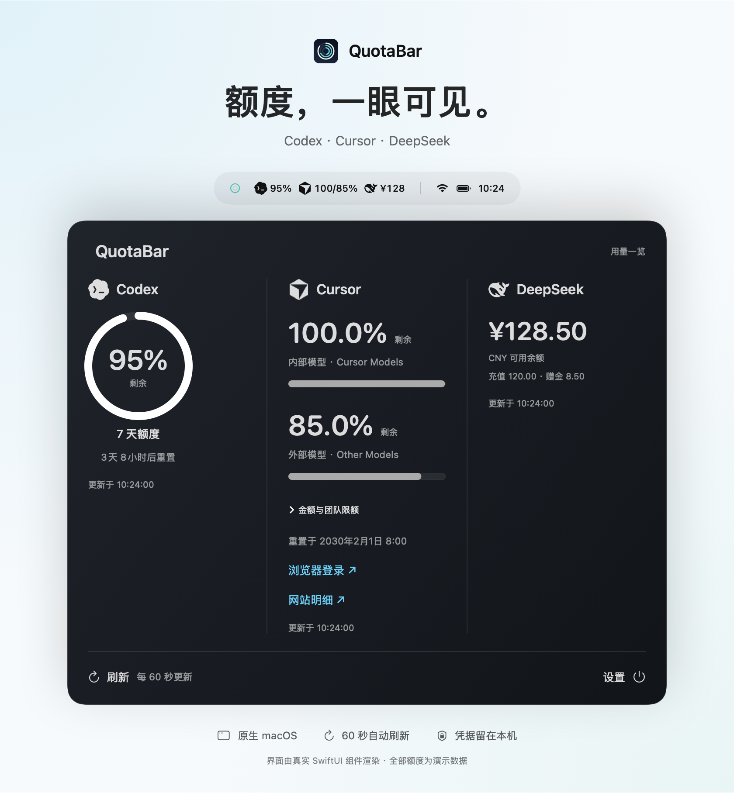
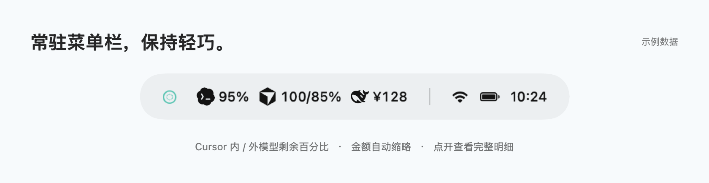
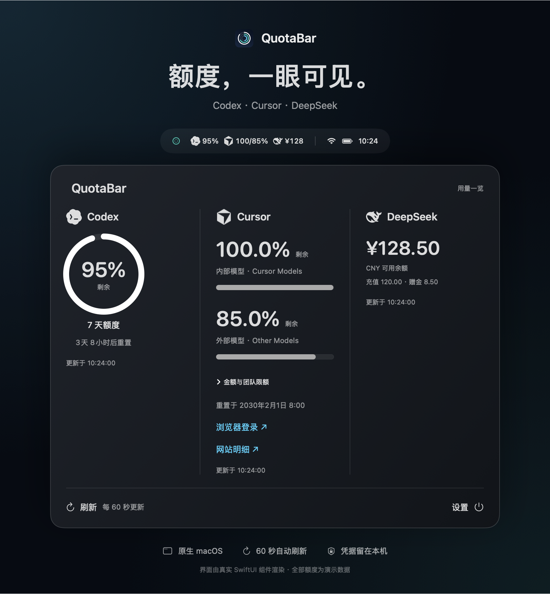
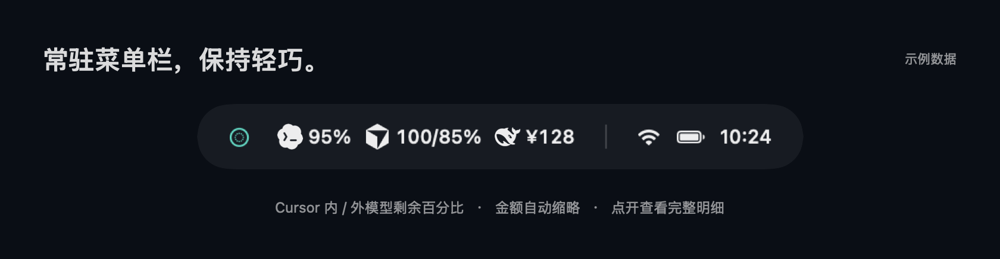

<div align="center">

# QuotaBar

**额度，一眼可见。**

原生macOS菜单栏额度工具，把三个平台的用量放在一处。

**Codex · Cursor · DeepSeek**

[界面预览](#界面预览) · [开始使用](#开始使用) · [隐私与数据](#隐私与数据) · [开发与测试](#开发与测试)

</div>

## 界面预览

<picture>
  <source media="(prefers-color-scheme: dark)" srcset="Docs/images/overview.png">
  <source media="(prefers-color-scheme: light)" srcset="Docs/images/overview-light.png">
  
</picture>

<p align="center"><sub>真实SwiftUI面板组件渲染，使用合成的演示额度。图中不包含真实账号、余额或企业用量。</sub></p>

<p align="center">深浅两套配图 · <a href="Docs/images/overview-light.png">查看浅色版</a> · <a href="Docs/images/overview.png">查看深色版</a></p>

### 轻巧常驻，展开看全

<picture>
  <source media="(prefers-color-scheme: dark)" srcset="Docs/images/menubar.png">
  <source media="(prefers-color-scheme: light)" srcset="Docs/images/menubar-light.png">
  
</picture>

<details>
<summary><strong>深色页面预览（不支持自动切换的阅读器可展开）</strong></summary>





</details>

菜单栏只保留最值得关注的数字：Codex剩余百分比、Cursor内部/外部模型剩余比例和DeepSeek余额。金额自动缩略；点击即可展开三栏等宽的磨砂面板，查看精确金额、周期、重置时间和额度明细。

- **原生质感**：SwiftUI与AppKit构建，透明单色服务图标，面板位于菜单栏下方。
- **及时更新**：每60秒自动刷新，也可手动刷新；支持登录Mac时启动。
- **清晰反馈**：每项显示更新时间，刷新失败保留上次成功值并说明原因。

### 三个平台，各看所需

**Codex**
通过本机已登录的CLI读取真实额度窗口，展示剩余比例与重置倒计时，不创建推理会话。

**Cursor**
以Cursor Models与Other Models两个额度池为主。面板保留一位小数；菜单栏先对齐到面板精度，再向下取整，例如`100.0% / 99.8%`显示为`100/99%`。金额及团队限额折叠展示。

**DeepSeek**
使用官方余额接口，区分可用余额、充值余额与赠金，支持多币种响应。

> `—`表示尚未读取；`!`表示最近一次刷新失败，而非余额不足。请结合面板里的更新时间和错误说明判断数据状态。

## 开始使用

需要**macOS 13或更新版本**，以及**Xcode Command Line Tools**。已在Apple Silicon环境验证，构建脚本使用当前机器的本机架构。

在克隆后的项目目录执行：

```sh
./build.sh
open QuotaBar.app
```

生成的应用使用本机ad-hoc签名，未经过Apple公证；重新构建后，系统可能再次请求钥匙串访问授权。

### 连接你的账号

1. **Codex**：先在CLI完成登录。QuotaBar会检测常见安装位置，也可在设置里填写CLI路径。
2. **Cursor**：点击「浏览器登录」，在系统默认浏览器完成认证。误关页面可「重新打开」或「取消登录」，等待超过90秒会自动恢复按钮。
3. **DeepSeek**：在设置中输入自己的API Key，可随时更新或删除。

取消或超时结束Cursor登录，会保留已有登录和额度数据。已取消请求的迟到回传不会覆盖当前会话。

## 隐私与数据

**凭据保存在本机，仓库不携带任何人的登录状态。**

- DeepSeek API Key与Cursor会话存储在macOS钥匙串中。
- Codex沿用本机CLI的登录状态。
- 没有项目自建的数据收集服务，额度请求由本机发送到各服务提供方。
- 代码、测试及文档使用合成数据；效果图不包含个人账号、真实余额或企业数据。
- `.gitignore`排除应用包、日志、会话文件和本地配置。CLI诊断会输出当前真实额度，分享前请自行脱敏。

## 开发与测试

```sh
# 构建
./build.sh

# 离线测试：不访问真实账户、钥匙串或外部网络
./QuotaBar.app/Contents/MacOS/QuotaBar --self-test
./QuotaBar.app/Contents/MacOS/QuotaBar --test-login

# 重新生成README中的脱敏效果图
./Docs/render-previews.sh
```

测试覆盖额度换算、模型百分比与取整、未知上限，以及登录超时、取消、重试、重复回调抑制、拒绝登录和浏览器启动失败。

<details>
<summary><strong>本机诊断与目录结构</strong></summary>

可选诊断参数：`--check`、`--check-cursor`、`--check-deepseek`。这些命令需要对应服务的登录状态，并会读取、输出真实额度。

```text
QuotaBar/
├── Sources/main.swift       原生界面、服务读取与凭据存储
├── Tests/LoginTests.swift   隔离网络和存储的登录流程测试
├── Assets/                 服务图标与应用图标
├── Docs/
│   ├── Preview.swift       真实组件与合成数据组成的效果图
│   ├── render-previews.sh  本地效果图生成脚本
│   └── images/             README预览图片
└── build.sh                编译、打包与本机签名
```

效果图脚本不会调用刷新或登录流程，不读取钥匙串或真实额度。面板复用应用的SwiftUI布局；离屏导出时以静态深色渐变近似桌面磨砂背景。菜单栏部分为相同比例与图标的示意排版。深浅配图通过`prefers-color-scheme`选择；不支持`picture`的阅读器使用浅色回退图，并提供可展开的深色预览和原图链接。面板保持应用本身的深色外观。

</details>

## 图标与服务

QuotaBar是独立项目，与所展示的服务无隶属关系。服务名称与标识归各权利人所有，仅用于标识集成服务。图标来源及第三方许可见[THIRD_PARTY_NOTICES.md](THIRD_PARTY_NOTICES.md)。QuotaBar三圆环应用图标由本项目绘制。

服务接口变更时，读取可能暂时失败；请查看面板中的错误说明。

## 许可证

项目原创代码及文档采用[MIT许可证](LICENSE)。第三方服务标识不受本项目代码许可证授权，使用时请遵守对应权利人的要求；详见[第三方声明](THIRD_PARTY_NOTICES.md)。
